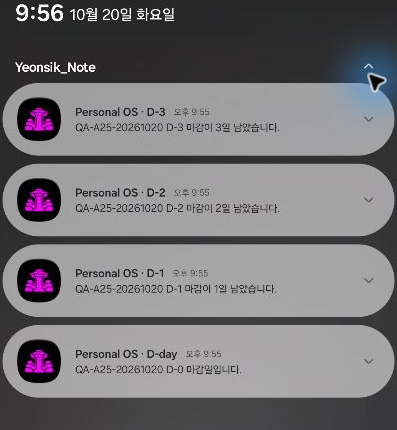
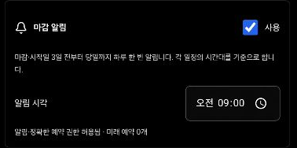

# Android deadline notification — Galaxy A25 실기기 검증

## 범위와 결과

- 날짜: 2026-10-20, Asia/Seoul. 실제 기기 시각 기준으로 기록했다.
- Branch: `feat/android-deadline-notifications-20261020`.
- 검증한 코드: `ff54ea4d3586820e7fed253699a7caec00d4eb84`.
- 기기: Galaxy A25 / SM-A256N, Android 16 / API 36.
- Package: `com.yeonsik.note`, versionName `1.0.0`, versionCode `1000000`, ARM64 debug APK.
- **이번 요청의 실기기 검증: PASS.** 기존 데이터를 유지한 업데이트, 권한 허용, 백그라운드에서 실제 알림 4건 도착, 마감일 수정·완료·삭제·복원 시 OS 예약 변경을 직접 확인했다.
- 최종 상태: **마감 알림 사용, 오전 09:00**, 알림 및 정확한 알람 권한 허용. QA 일정 5건은 앱의 soft-delete로 정리했다. QA 예약 0건, 앱의 AlarmManager 예약 0건, 표시 중인 QA 알림 0건이다. 기존 할 일 7건은 유지했다.
- Supabase 인증 없이 기기의 기존 local/offline scope에서 테스트했다. 운영 DB 쓰기, migration, MCP/OAuth 구현 및 main merge는 수행하지 않았다.
- **전체 release merge 판정: BLOCKED 유지.** 기존 동일 계정 Windows↔Android 실제 sync 검증을 이 Android 로컬 검증으로 대체하지 않는다.

## 업데이트와 데이터 보존

설치된 APK와 새 APK의 package/version 및 서명 인증서가 같은 것을 확인한 뒤 `adb install -r`로 업데이트했다. 앱 삭제, `pm clear`, 로컬 snapshot/pending 삭제는 사용하지 않았다.

| 항목 | 실제 결과 |
| --- | --- |
| 최초 구현 APK 업데이트 | Success. 앱을 실행하기 전 비교한 데이터 파일 14개 모두 SHA-256 동일 |
| receiver 수정 APK 재업데이트 | Success. 직전 로컬 QA Action과 tombstone을 포함한 데이터 파일 14개 모두 SHA-256 동일 |
| firstInstallTime | 기존 `2026-06-06 18:06:58` 유지 |
| 수정 APK lastUpdateTime | `2026-10-20 21:49:45` |
| 서명 인증서 SHA-256 | `cad84c2b4d6f3ad776d880794e00333953840746fb27424531c9f5a6e2846135` — 설치본과 후보 일치 |
| 실행 | 수정 APK cold launch `am start -W`: Status ok |
| 기존 예약 업그레이드 | 미래 legacy 예약 6건을 같은 ID로 교체. ID 차이 0건, native payload의 `extra` 0건 |

기존 snapshot, WebView local storage, shared preferences 및 device 데이터의 비교용 원본과 백업은 개발 환경의 비공개 임시 디렉터리에 보존했다. 계정·토큰·원본 사용자 데이터는 Git에 포함하지 않았다. 앱 사용 후의 정상 변경까지 모든 파일이 영구히 동일하다고 주장하지 않는다. 실제 pending conflict가 존재하는 계정의 end-to-end 복구는 이번에 실행하지 않았다.

## 실기기에서 발견한 실패와 수정

최초 APK는 native 예약 등록과 pending 조회가 성공했지만, **21:45:00.165**에 실제 예약 발송 receiver가 다음 오류로 종료됐다.

```text
Unable to start receiver app.tauri.notification.TimedNotificationPublisher
UnrecognizedPropertyException: Unrecognized field "personalOsDeadlineKey"
(class app.tauri.plugin.JSObject)
```

Pinned notification plugin 2.3.3이 예약 `sourceJson`을 발송 시 역직렬화할 때 임의의 `extra` 속성을 읽지 못하는 문제였다. 예약 성공을 전달 성공으로 판정하지 않고 실패를 별도로 기록했다. 최초 APK SHA-256은 `E1E31E85D6C8339F76665EDD6C77A749D168968BD0A40834480CFCCFB2F2CD64`이며 이 산출물은 교체됐다.

`ff54ea4`의 수정 파일은 다음 5개다. 경로 기준은 `src/features/deadline-notifications/`이다.

| 파일 | 수정 |
| --- | --- |
| `tauriDeadlineTransport.ts` | native payload와 저장 sourceJson에서 `extra` 제거. 소유 예약 식별은 기존 로컬 journal 사용 |
| `deadlinePlanner.ts` | `nativeRevision: 2`로 기존 payload를 같은 ID로 한 번 재등록 |
| `deadlineStorage.ts` | legacy journal과 revision 2를 안전하게 읽음 |
| `tauriDeadlineTransport.test.ts` | native·persisted payload 모두 `extra` 없음 검증 |
| `deadlineNotifications.test.ts` | 기존 예약 ID·다른 알림 보존, 한 번만 교체하는 회귀 테스트 추가 |

Task, Action import, sync, ownership 및 기존 DB migration history는 수정하지 않았다. 수정 APK는 별도 데이터 초기화 없이 재설치했다.

## 권한과 실제 도착

1. 앱 설정에서 시각을 정하고 사용을 켰다. 실제 Android 알림 권한 대화상자에서 허용했다.
2. 정확한 알람 권한이 없는 상태에서는 앱이 사용 상태로 남지 않고 설정 진입 안내를 표시했다.
3. 앱의 설정 버튼으로 Android의 **알람 및 리마인더** 화면을 열어 해당 앱 권한을 허용했다.
4. 앱으로 돌아와 사용을 켰다. OS에서도 `POST_NOTIFICATIONS: granted=true`, `SCHEDULE_EXACT_ALARM: allow`를 확인했다.
5. 수정 APK에서 검증 시각을 21:55로 변경한 뒤 Samsung 홈으로 이동해 앱을 백그라운드에 뒀다. 강제 종료는 하지 않았다.
6. 21:55에 아래 네 알림이 Android NotificationManager에 실제 게시됐고, Samsung 알림창을 열어 네 카드의 제목과 본문을 직접 확인했다.

| 알림 | Action 마감일 | 실제 OS 생성 시각 KST | notification ID |
| --- | --- | --- | --- |
| D-day | 2026-10-20 | 21:55:00.207 | 579077439 |
| D-1 | 2026-10-21 | 21:55:00.252 | 1606255369 |
| D-2 | 2026-10-22 | 21:55:00.308 | 1658017022 |
| D-3 | 2026-10-23 | 21:55:00.341 | 140496670 |

Android가 만든 자동 그룹 요약 ID 0은 별도 deadline 알림으로 집계하지 않았다. 해당 실행의 앱 PID crash buffer에 FATAL/Exception이 없었다. 발송 후 native 예약과 AlarmManager는 모두 14건에서 10건으로 감소했다.

네 개의 QA Action으로 D-3..D-day 각 분기를 같은 실제 시각에 검증했다. 하나의 Action을 4일 연속 관찰한 결과는 아니다. 기기는 무음 상태여서 소리·진동은 확인하지 않았다.



스크린샷은 QA 알림 영역만 잘라 다른 앱의 알림을 제외했다.

## 수정·완료·삭제·복원 검증

별도 `QA-A25-20261020 MUTATION` Action 하나를 실제 앱 UI에서 조작했다. 모든 단계에서 native 저장소와 Android AlarmManager를 함께 읽었다. 아래 전체 예약 수에는 나머지 QA 일정의 미래 예약 6건이 포함된다.

| 최종 APK에서 수행한 단계 | 전체 native / OS 예약 | MUTATION 예약 | 결과 |
| --- | --- | --- | --- |
| 미완료, 마감 10월 25일 | 10 / 10 | 4 | 10월 22..25일, 21:55 |
| 완료 | 6 / 6 | 0 | 해당 Action의 예약만 취소 |
| 완료 해제 | 10 / 10 | 4 | 동일 예약 ID로 재등록 |
| 마감 10월 26일로 수정·저장 | 10 / 10 | 4 | 10월 23..26일로 교체. 22일 제거, 겹치는 3일의 ID 유지 |
| 삭제 | 6 / 6 | 0 | tombstone 유지, 해당 예약 취소 |
| 같은 external identity, 원래 마감 24일로 재가져오기 | 6 / 6 | 0 | 자동 복원·수정 덮어쓰기 없음 |
| 삭제 상세에서 명시적 복원 | 10 / 10 | 4 | 사용자 수정 마감 26일 유지. 삭제 전 예약 ID·시각 모두 일치 |
| QA 일정 5건 최종 삭제 | 0 / 0 | 0 | 기존 사용자 항목은 유지 |

수정 전후 기록과 발송 결과의 비공개 원본에서 개인 데이터가 없는 항목만 추린 [검증 데이터](assets/android-deadline-a25-evidence-20261020.json)를 함께 기록했다. 화면에서 조작한 결과이며 DB를 직접 편집해 상태를 만들지 않았다.

## 자동 회귀 및 산출물

모든 명령은 수정 코드 `ff54ea4`를 기준으로 2026-10-20 Windows 개발 환경에서 실행했다.

| 검증 | 결과 |
| --- | --- |
| `npm.cmd test` | PASS — 52 files / 350 tests. Action/import/sync/ownership, Task/Records/calendar 및 알림 회귀 포함 |
| `npm.cmd run typecheck` | PASS |
| production web build | PASS — 두 native build의 `beforeBuildCommand`에서 `npm.cmd run build` 실행 |
| `pwsh -NoProfile -ExecutionPolicy Bypass -File scripts/build-android-arm64.ps1` | PASS — ARM64 debug APK. 기존 Windows symlink 권한 제한에 대한 copy/Gradle fallback 및 native library hash 확인 |
| `npm.cmd run tauri:build` | PASS — Windows x64 NSIS. 기존 Rust dead-code 경고 3개 |
| 프로젝트 문서 validator / Notion render-only dry run | PASS — 문서 오류·경고 0, 두 문서 render 검증 성공. 외부 Notion 쓰기 없음 |

| 최종 산출물 | SHA-256 |
| --- | --- |
| `src-tauri/gen/android/app/build/outputs/apk/arm64/debug/app-arm64-debug.apk` | `7A4C476E646CD8CA7FC044BF17820CD8A91850914CC275B188595F195DB6FEDC` |
| `src-tauri/target/release/bundle/nsis/Yeonsik_Note_1.0.0_x64-setup.exe` | `7A887D2E67C722B0E9179E01A1430CD02F306D6CCB4A9A77F86F40BD701B4D00` |

## 최종 사용자 설정과 UNVERIFIED

요청대로 알림을 켜두고 **오전 09:00**으로 저장했다. QA 알림 그룹만 알림창에서 닫았으며 다른 앱 알림은 유지했다. 현재 미완료·미삭제 confirmed Action 중 알림 대상이 없어 미래 예약은 0건이다. 이후 조건에 맞는 Action을 기기에 저장·수신하면 이 시각으로 예약된다.



다음은 **UNVERIFIED**로 유지한다.

- 실제 동일 Supabase 계정의 Windows↔Android 생성·수정·삭제·재가져오기와 인증된 계정의 pending conflict upgrade.
- 재부팅 후 복구·catch-up, Doze, 강제 종료, 제조사 배터리 제한 및 날짜·시간대 변경 상황의 실제 전달.
- 실제 OS 권한 거부·회수 후의 실기기 재예약 흐름. 자동 테스트 범위와 허용 경로의 실기기 검증을 구분한다.
- 단일 Action의 4일 연속 도착, 최종 오전 09:00의 다음 날 도착, 소리·진동. 이번 실제 도착 검증은 21:55에 실행했다.

이 한계를 제외한 이번 Android 로컬 알림 검증은 완료했다. 기존 Action Calendar release의 미검증 blocker를 해제하거나 main에 병합하지 않았다.
